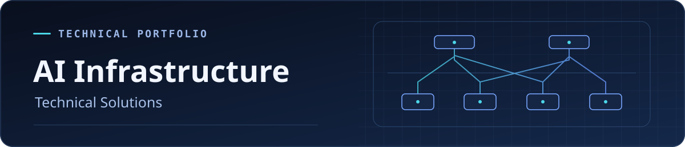

# Hi, I’m C127xixi-lin

**Technical Solutions · AI & Cloud · Customer Enablement**

## About Me

I’m interested in making complex AI infrastructure easier to evaluate, explain, and adopt. I focus on GPU clusters, LLM serving, and healthcare AI platforms, and I’m pursuing customer-facing roles in technical support, solutions engineering, and technical sales.

## Focus Areas

`AI Infrastructure` · `LLM Serving` · `Technical Support` · `Solution Design`

- **Requirements discovery:** Translate workload, latency, and site constraints into sizing assumptions and design trade-offs.
- **Infrastructure planning:** Explore GPU and rack sizing, InfiniBand and RoCE trade-offs, and inference capacity.
- **Technical validation:** Define proof-of-concept criteria for model and accelerator compatibility, performance, and reliability.

## Selected Work

**Sizing a 300 PFLOP/s AI training cluster**

Given a hypothetical customer brief, I clarify what “300P” means, estimate the first-pass GPU and rack requirements, and lay out how to validate network, training, and storage performance before procurement.

**304 H100 GPUs · 38 compute nodes · 19 compute racks**  
*Illustrative design estimate under stated assumptions, not measured performance.*

<strong>Read the full case study</strong>

### Sizing a 300 PFLOP/s AI Training Cluster

A customer asks for “300P of AI compute.” This case shows how I turn that one-line brief into a first-pass infrastructure design: **38 eight-GPU nodes and 19 compute racks**, with a clear list of what still needs to be tested before procurement.

> Portfolio case study using a hypothetical customer and public hardware specifications. The sizing below is a worked example, not a deployed system, benchmark result, or tool-generated report.

#### 1. Clarify the requirement

My first question is: **Does 300 PFLOP/s mean dense BF16 theoretical peak, or sustained throughput on a specific training workload?** Those targets cannot be sized the same way. For this example, I assume a **300 PFLOP/s dense BF16 peak** target and **24 kW of usable power per compute rack**.

Before finalizing the design, I would confirm the model, training deadline, and parallelism plan; ask about dataset size, ingest rate, and checkpoint frequency; and confirm the site's power, cooling, and network constraints.

#### 2. Build a first-pass configuration

| Area | Initial estimate | What still needs confirmation |
| --- | --- | --- |
| GPU compute | 38 NVIDIA DGX H100 nodes × 8 H100 SXM GPUs = **304 GPUs** and approximately **301 PFLOP/s** dense BF16 theoretical peak. | GPU memory requirements, measured training throughput, multi-node scaling, and any spare capacity. |
| Rack and power | Two nodes per 24 kW rack. At up to 10.2 kW per node, that is **20.4 kW per fully populated compute rack** and **19 compute racks**. Maximum compute-node IT draw is **387.6 kW**. | Usable capacity under the site's power redundancy policy, cooling at full load, rack fit, and separate network, storage, and management loads. |
| Compute network | Use **400 Gb/s InfiniBand** as the reference design. If all eight compute interfaces per node are connected, the cluster needs **304 host-to-fabric links**. | Size leaf and spine switches from logical port counts, uplinks, and the required oversubscription and failure behavior. Host links are not a switch, optics, or cable bill of materials. |
| Storage | Plan a fast tier for active datasets and checkpoints, with a separate capacity tier for retained checkpoints and archival data. Keep storage traffic separate from GPU collectives in the reference design. | Size usable capacity from the dataset, concurrent jobs, retention, and protection overhead. Size write bandwidth from total checkpoint bytes due within the allowed window; test read throughput and restore time separately. |

**Compute math:** 300 PFLOP/s ÷ (8 × ~0.989 PFLOP/s per GPU), rounded up, gives 38 nodes. [NVIDIA’s H100 SXM specification](https://www.nvidia.com/en-us/data-center/h100/) lists 1,979 TFLOP/s for BF16 **with sparsity**; this estimate uses approximately half that rate for dense BF16. The [DGX H100 specifications](https://docs.nvidia.com/dgx/dgxh100-user-guide/introduction-to-dgxh100.html) provide the GPU count, network interfaces, and maximum system power. The [DGX H100 data center planning guide](https://docs.nvidia.com/dgx-superpod/design-guides/dgx-superpod-data-center-design-h100/latest/planning.html) provides reference rack layouts.

#### 3. Define acceptance tests

1. **Fabric:** Establish a single-node NCCL all-reduce baseline. Compare same-rack and cross-rack runs at matched GPU counts and message sizes. Verify worker placement and transport, then compare correctness and bandwidth against agreed baselines. [NVIDIA NCCL validation guide](https://docs.nvidia.com/run-ai/self-hosted/v3.0/documentation/tutorials/training-tutorials/nccl-tests).
2. **Training:** Run a representative job with the intended model, sequence length, batch size, and parallelism strategy. Measure tokens per second and scaling efficiency before committing to a training deadline.
3. **Storage:** Write and restore a representative checkpoint under concurrent data loading. Check both elapsed time and whether the training job resumes correctly.

#### About the configuration workflow

This example is based on a Markdown configuration skill and an HTML report template. The workflow takes a GPU model, compute target or GPU count, network type, and rack power limit, then guides a first-pass design across compute, networking, and storage. The numbers in this README can be reviewed without the skill or access to a GPU cluster.

## Let’s Connect

[GitHub](https://github.com/C127xixi-lin) · **WeChat: inspiration1806**

Outside of tech, I enjoy exploring the world.
