# Hi, I’m C1806xixi-lin

I work on AI infrastructure planning with a focus on healthcare. My notes here cover two questions that come up in sizing discussions: will the model fit on the proposed GPUs, and will the service still meet its latency target when traffic picks up?

I’m interested in customer-facing technical support, solutions engineering, and technical pre-sales roles.

## Projects

### [500 PFLOP/s healthcare AI compute center](./case-studies/healthcare-ai-compute-center.md)

A reference design for a shared hospital research and inference platform. I sized an eight-GPU node layout, worked through the switch port counts and storage load, and wrote down the tests I’d require before signing off. The 500 PFLOP/s target is dense FP16 peak; the serving targets have their own tests.

### [LLM inference GPU sizing skill](./skills/inference-gpu-sizing/)

I put this together for people sizing a model deployment. It takes a model, prompt and response lengths, traffic, and latency targets, then walks through GPU candidates, memory fit, and what to measure before deciding on a card count.

### [Why is the first token slow?](https://github.com/C1806xixi-lin/llm-latency-troubleshooting)

A small Python lab for telling queueing, long-prompt prefill, and slow token generation apart. It uses simulated logs and runs without a GPU.

## Contact

WeChat: `inspiration1806`
